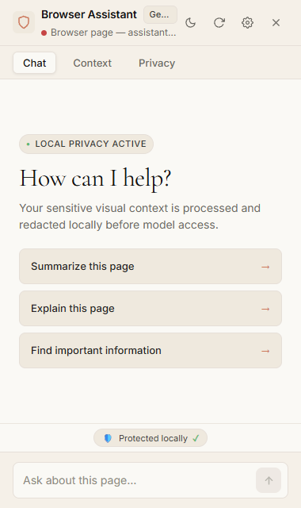
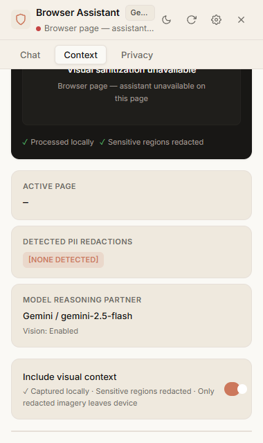
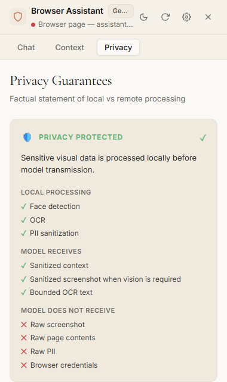
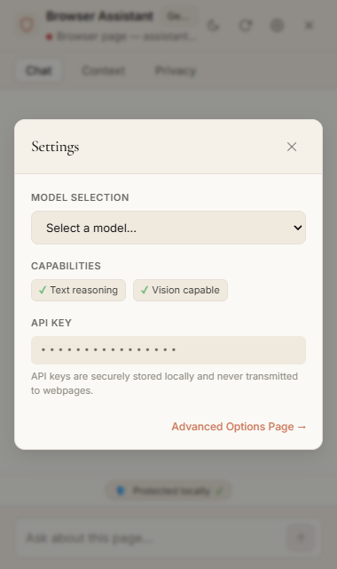

# SIH26171 — Privacy-Preserving Browser AI Assistant

> **Submission ID**: SIH26171 · **Version**: 1.6.0 · **Platform**: Google Chrome Manifest V3 · **Status**: Release Candidate (252/252 tests passing)

A pure client-side Chrome extension that lets you give AI assistants control over your browser **without exposing your raw screen contents to the cloud**. Sensitive visual processing runs 100% on-device. The AI model reasons only over sanitized abstractions. Actions are grounded, validated, and bounded.

---

## Screenshots

| Chat Interface | What the AI Sees | Privacy Status | Settings |
|:---:|:---:|:---:|:---:|
|  |  |  |  |

---

## The Problem

Modern browser agents need to see your screen to be useful — but your screen contains your most private data:

- **Personal data**: Emails, phone numbers, names, addresses
- **Financial data**: Bank balances, credit card numbers, statements
- **Medical data**: Health records, prescriptions, patient details
- **Credentials**: Passwords, API keys, session tokens

Conventional browser agents solve this with an **all-or-nothing approach**: stream raw, unredacted screenshots to cloud providers, or give LLMs direct unrestricted browser control (via DevTools Protocol, `eval()`, or arbitrary CSS/XPath selectors).

Both approaches are unacceptable:

1. **Privacy breach**: Raw screenshots of sensitive data sent to cloud servers.
2. **Safety breach**: Models with unrestricted browser access can cause irreversible harm via prompt injection, hallucination, or rogue automation loops.

---

## The Solution

SIH26171 deploys a **dual-barrier client architecture** entirely within the user's browser:

| Barrier | What It Does |
|---|---|
| **Local Privacy Engine** | CV, OCR, and PII detection run on-device. Sensitive regions are redacted before any data leaves the machine. |
| **Authoritative Action Firewall** | The model never touches browser APIs directly. It proposes semantic intents. The firewall validates and executes only safe, bounded actions. |

**Zero remote backend.** Zero Python. Zero external server dependencies. Pure Chrome MV3 client-side execution.

---

## Architecture Pipeline

```
PAGE (DOM)
  |
  v
[1] DOM PERCEPTION & ELEMENT EXTRACTION (content.js)
  |  Traverses interactive DOM. Assigns generation-scoped IDs: el_1, el_2, ...
  |  Registers elements into ElementRegistry.
  |
  v
[2] SCREENSHOT CAPTURE (background.js)
  |  chrome.tabs.captureVisibleTab() -- captured strictly in memory.
  |
  v
[3] LOCAL VISUAL PIPELINE (Offscreen Document -- isolated sandbox)
  |  +-- MediaPipe BlazeFace  -> Face detection (WebAssembly, on-device)
  |  +-- Canvas Redaction     -> Solid fill over detected sensitive regions
  |  +-- Tesseract.js OCR     -> Runs ONLY on the already-redacted canvas
  |
  v
[4] PII DETECTION & CONTEXT SANITIZATION
  |  Regex + DOM detectors identify emails, phones, card numbers, secrets.
  |  Replaced with structured category tokens: [EMAIL_1], [PHONE_1], etc.
  |  Reverse mapping is device-local only. Never crosses the network.
  |
  v
[5] GENERATION & TAB BINDING GATE (background.js)
  |  5-check invariant gate before any network dispatch:
  |  Active tab match, Generation match, Navigation identity match,
  |  Context validity, Screenshot ownership verification
  |
  v
[6] SANITIZED CONTEXT -> CONFIGURED MODEL PROVIDER
  |  Gemini (multimodal) / Groq / OpenRouter / Local
  |  Model receives: sanitized text tokens + locally-redacted image (if vision)
  |  Model NEVER receives: raw screenshots, raw OCR, raw PII
  |
  v
[7] STRUCTURED INTENT PROPOSAL (single JSON action per step)
  |  e.g. { "status": "continue", "action": { "type": "click", "elementId": "el_1" } }
  |
  v
[8] ELEMENT REGISTRY GROUNDING (grounding.js + elementRegistry.js)
  |  Resolves elementId -> verified active DOM node.
  |  Cross-verifies semantic roles, bounding boxes, generation.
  |
  v
[9] ACTION FIREWALL (validate.js)
  |  Allowlist check: click, type, scroll (only)
  |  Generation check: action generation == active DOM generation
  |  Target check: node is interactable, visible, non-disabled, non-protected
  |  Selector injection check: no raw CSS/XPath permitted
  |
  v
[10] SAFE SYNTHETIC EXECUTION (execute.js)
  |  Dispatches trusted synthetic events (focus, mousedown, mouseup, click).
  |  Dispatches input/change for reactive framework compatibility.
  |  Zero eval(). Zero new Function(). Zero executeScript().
  |
  v
[11] RE-OBSERVATION & LOOP DETECTION (agentCoordinator.js)
  |  150ms DOM settle wait. Navigation/state change check.
  |  Repeated identical actions -> LOOP_DETECTED -> abort.
  |
  v
[12] TRANSACTION COORDINATOR (next step or clean termination)
     MAX_STEPS = 5, MAX_TRANSACTION_TIME_MS = 30,000ms
```

---

## Privacy Boundary

### LOCAL — On-Device (never transmitted)

| Data | Processing |
|---|---|
| Raw viewport capture | `chrome.tabs.captureVisibleTab()` — in memory only |
| Face regions | MediaPipe BlazeFace (WebAssembly, Offscreen Document) |
| Canvas redaction | Solid-fill masking over sensitive visual regions |
| OCR text | Tesseract.js (WebAssembly, executed on redacted canvas only) |
| PII patterns | Regex + DOM detectors (emails, phones, card numbers, passwords) |
| Context sanitization | PII replaced with category tokens; reverse map is device-local |

### TRANSMITTED TO CONFIGURED CLOUD PROVIDER

| Data | Condition |
|---|---|
| Sanitized user prompt | Always |
| Sanitized page text context (PII replaced with tokens) | Always |
| Locally-redacted screenshot | Only if vision model enabled and user permitted |
| Bounded OCR text from redacted canvas (<500 chars) | Only if available |

### NEVER TRANSMITTED

- Raw, unredacted screenshots
- Raw, unredacted OCR output
- Unsanitized PII (passwords, emails, phone numbers, credit cards)
- Browser cookies, credentials, or session tokens
- Full unparsed DOM trees or inline scripts

---

## Safety Boundary

| Allowed Actions | Blocked by Firewall |
|---|---|
| `click` | `eval()`, `new Function()` |
| `type` | `javascript:` URIs |
| `scroll` | Arbitrary CSS selectors or XPath queries |
| | `chrome.tabs.executeScript` or dynamic script injection |
| | Chrome DevTools Protocol commands |
| | Cross-tab execution |

---

## Multi-Step Agent Guarantees

| Guarantee | Value |
|---|---|
| Maximum steps per transaction | 5 |
| Transaction timeout | 30 seconds |
| Actions per step | 1 (batch execution prohibited) |
| DOM settle wait between steps | 150 ms |
| Retry limit | 1 (for transient anomalies) |
| Loop detection | Active — repeated unchanged actions trigger `LOOP_DETECTED` |
| Navigation invalidation | Immediate — active transaction aborted as `STALE` |
| Tab isolation | Strict by `tabId` — no cross-tab execution |
| Generation staleness | Monotonic counter — stale actions rejected fail-closed |

---

## Technology Stack

| Component | Technology |
|---|---|
| Extension Platform | Google Chrome Manifest V3 (MV3) |
| Language | Vanilla JavaScript (ES2022) + Web APIs |
| Service Worker | Chrome Background Service Worker (`background.js`) |
| Visual Isolation | Chrome Offscreen Document (`offscreen.html` / `offscreen.js`) |
| Face Detection | MediaPipe BlazeFace (WebAssembly) |
| OCR Engine | Tesseract.js v7 (WebAssembly, English) |
| Credential Storage | `chrome.storage.local` (privileged extension sandbox) |
| Model Providers | Google Gemini · Groq · OpenRouter · Local (stub) |
| Testing | Node.js test harness + Puppeteer (Real Chrome MV3 E2E) |

---

## File Structure

```
SIH2026/
+-- extension/                      # Chrome MV3 extension (the product)
|   +-- manifest.json               # MV3 manifest: permissions, CSP, routes
|   +-- background.js               # Service worker: tab lifecycle, generation
|   |                               #   management, screenshot capture, provider
|   |                               #   gateway, offscreen routing
|   +-- content.js                  # Content script: DOM perception, mutation
|   |                               #   scheduling, analysis pipeline, action exec
|   +-- sidebar.html / sidebar.js   # Chrome Side Panel UI (primary interface)
|   +-- sidebar.css / theme.css     # Design system and CSS variables
|   +-- options.html / options.js   # Provider configuration (MV3 options_ui)
|   +-- popup.html / popup.js       # Toolbar popup (privacy status summary)
|   +-- elementRegistry.js          # Element ID <-> DOM node (generation-scoped)
|   +-- grounding.js                # Resolves model element IDs to verified DOM
|   +-- validate.js                 # Action firewall (allowlist, generation, target)
|   +-- execute.js                  # Trusted synthetic event dispatcher (no eval)
|   +-- agentCoordinator.js         # Bounded multi-step agent loop coordinator
|   +-- modelManager.js             # Provider abstraction + pre-flight PII scan
|   +-- sanitize.js                 # PII detection[] -> SanitizedContext builder
|   +-- perceptionSchema.js         # Canonical detection shape and categories
|   +-- detectionFusion.js          # Multi-source detection merge with provenance
|   +-- detectionGate.js            # Cost-based gate: decides runOcr / runCv flags
|   +-- metrics.js                  # PII-free numeric timing instrumentation
|   +-- logger.js                   # Structured logger with Base64/key scrubbing
|   +-- offscreen.html              # Offscreen Document host page
|   +-- offscreen.js                # Offscreen message handler and worker bridge
|   +-- detectors/
|   |   +-- domDetector.js          # DOM attribute-based PII detector
|   |   +-- regexDetector.js        # Regex-based PII detector (email, phone, card)
|   |   +-- ocrDetector.js          # Tesseract OCR gated detector + PII classifier
|   +-- providers/
|   |   +-- geminiProvider.js       # Google Gemini adapter (multimodal, vision)
|   |   +-- groqProvider.js         # Groq adapter (text-only)
|   |   +-- openRouterProvider.js   # OpenRouter adapter (text-only)
|   |   +-- localProvider.js        # Local model stub (honest unavailable state)
|   |   +-- types.js                # Shared provider response normalization
|   +-- vision/
|   |   +-- visualPipeline.js       # Orchestrates screenshot -> offscreen -> enrich
|   |   +-- visualWorker.js         # Off-main-thread: MediaPipe + canvas redaction
|   +-- icons/                      # Extension icon set (16, 48, 128px)
|   +-- vendor/                     # Vendored WebAssembly runtimes (~88 MB total)
|       +-- tesseract/              # Tesseract.js v7 + WASM variants + eng.traineddata
|       +-- mediapipe/              # MediaPipe Tasks Vision + BlazeFace model
|
+-- docs/                           # Public-facing project website (GitHub Pages)
|   +-- index.html                  # Main website (features, architecture, install)
|   +-- styles.css                  # Website design system
|   +-- script.js                   # Website interactivity (theme, gallery, modal)
|   +-- assets/screenshots/         # Current extension UI screenshots
|   +-- ARCHITECTURE_DIAGRAM.md     # ASCII system block diagram
|   +-- FINAL_ARCHITECTURE.md       # 12-stage pipeline with subsystem details
|   +-- THREAT_MODEL.md             # 15-vector threat matrix with test references
|   +-- JUDGE_TECHNICAL_SUMMARY.md  # Judge-facing technical brief
|   +-- PRESENTATION_CONTENT.md     # 10-slide deck content outline
|   +-- DEMO_SCRIPT.md              # 3-minute live presentation script
|   +-- DEMO_RECORDING_CHECKLIST.md # Video recording protocol checklist
|
+-- tests/                          # Automated test suites
|   +-- run_privacy_tests.js        # Node.js: P1-P252 privacy regression suite
|   +-- test_phase10_release.js     # Real Chrome: 24-point release candidate
|   +-- test_phase13_ui.js          # Real Chrome: UI screenshot capture
|   +-- test_phase14_stale_recovery.js  # Real Chrome: generation/stale recovery
|   +-- test_phase7_grounding.js    # Real Chrome: grounding & action validation
|   +-- test_phase8_agent_loop.js   # Real Chrome: multi-step agent loop
|   +-- test_phase9_hardening.js    # Real Chrome: production hardening
|   +-- test_phase5_ocr.js          # Real Chrome: local OCR runtime
|   +-- test_real_chrome_bootstrap.js   # Real Chrome: content script bootstrap
|   +-- test_website.js             # Puppeteer: public website validation
|   +-- release_manifest_audit.js   # Manifest integrity audit (P156-P160)
|   +-- fixtures/
|   |   +-- demo_workflow.html      # Canonical deterministic 3-step demo page
|   +-- *.html                      # Browser-native unit test pages
|
+-- demo/                           # Standalone demo assets
+-- SIH26171_MD_Pack/               # Original submission documentation pack
+-- RELEASE_CHECKLIST.md            # Pre-release verification checklist
+-- RELEASE_VERSION.md              # Verified performance benchmarks snapshot
+-- VERSION                         # Current version string (1.6.0)
+-- README.md                       # This file
```

---

## Installation

### 1. Load the Extension in Chrome

1. Open Google Chrome and navigate to `chrome://extensions`
2. Enable **Developer mode** (toggle in the upper-right corner)
3. Click **Load unpacked** and select the `extension/` folder from this repository
4. The extension icon appears in the Chrome toolbar

### 2. Open the Privacy Assistant Sidebar

1. Click the extension icon in the toolbar **or** open Chrome's Side Panel (View ? Side Panel)
2. Select **Privacy Assistant** from the Side Panel dropdown
3. The assistant opens showing a **PRIVACY PROTECTED** status indicator

### 3. Configure a Model Provider

1. Right-click the extension icon ? **Options** (or click the settings gear in the sidebar)
2. Select a provider: **Google Gemini**, **Groq**, **OpenRouter**, or **Local Model**
3. Enter your API key (input is masked with bullets)
4. Select an available model from the dropdown
5. Click **Test connection** to verify connectivity, then **Save configuration**

> **API Key Storage**: Keys are stored in `chrome.storage.local` — protected from web content scripts but accessible to the local OS user controlling the browser profile.

### 4. Run the Canonical Demo

Open `tests/fixtures/demo_workflow.html` in Chrome, then type **"Complete this workflow."** into the assistant:

- **Step 1**: Grounds `Start Workflow` button ? `el_1` ? validated ? clicked
- **Step 2**: Re-observes DOM ? grounds `Continue` ? `el_2` ? clicked
- **Step 3**: Re-observes DOM ? grounds `Complete` ? clicked ? *"Workflow completed."*
- Click **Reset Workflow** to repeat deterministically

---

## Testing & Verification

### Automated Regression Suite (Node.js)

```powershell
node tests/run_privacy_tests.js
```

**Current result: 252 passed, 0 failed (100% PASS)**

Tests cover: PII detection, context sanitization, ElementRegistry grounding, action firewall, generation staleness, tab isolation, loop detection, navigation invalidation, provider payload gates, screenshot ownership verification, content script bootstrap/recovery, and stale-element recovery.

### Real Chrome Integration Suites (Puppeteer)

| Suite | File | Coverage |
|---|---|---|
| Phase 5 — Local OCR | `test_phase5_ocr.js` | Tesseract WASM runtime, warm/cold timing |
| Phase 7 — Grounding | `test_phase7_grounding.js` | ElementRegistry, action validation |
| Phase 8 — Agent Loop | `test_phase8_agent_loop.js` | Multi-step coordinator, loop detection |
| Phase 9 — Hardening | `test_phase9_hardening.js` | Navigation races, provider failures |
| Phase 10 — Release | `test_phase10_release.js` | 24-point release candidate verification |
| Phase 13 — UI | `test_phase13_ui.js` | Sidebar UI screenshots |
| Phase 14 — Stale Recovery | `test_phase14_stale_recovery.js` | Generation sync, stale-element fix |
| Bootstrap | `test_real_chrome_bootstrap.js` | Content script injection & PING/PONG |
| Website | `test_website.js` | Public website layout & accessibility |

### Manifest Integrity Audit

```powershell
node tests/release_manifest_audit.js
```

Verifies no dead code, no missing files, no leaked permissions (P156–P160 PASS).

### Real Chrome Leak Audit (Zero Leaks Verified)

| Leak Type | Count |
|---|---|
| Raw screenshot transmissions | **0** |
| Raw OCR text in console/network | **0** |
| API key exposures | **0** |
| Authorization header leaks | **0** |
| Arbitrary action executions | **0** |

---

## Performance Benchmarks

Measured on real Chrome instances via automated Puppeteer test harness:

| Operation | Median Latency |
|---|---|
| DOM Perception & Element Extraction | 1.4 ms |
| Local Face Detection & Canvas Redaction | 11.8 ms |
| Local OCR — warm Tesseract canvas | 61.2 ms |
| Local OCR — cold start (WASM load, one-time) | ~2.96 s |
| Action Firewall Validation | 0.8 ms |
| DOM Synthetic Event Dispatch | 1.8 ms |
| Complete 3-Step Autonomous Workflow | ~810 ms |

---

## Configuration

All settings are stored in `chrome.storage.local` within the privileged extension sandbox:

| Setting | Location | Values |
|---|---|---|
| Active provider | Options page | `gemini` / `groq` / `openrouter` / `local` |
| Model selection | Options page | Provider-dependent (fetched from provider API) |
| API key | Options page | Masked input; never exposed in UI or logs |
| Screenshot sharing | Sidebar settings | Toggle — enabled only for vision-capable models |
| Theme | Sidebar settings | `dark` / `light` (persisted to storage) |

---

## Known Limitations

1. **OCR Cold Start**: Initial Tesseract WebAssembly load in the Offscreen Document takes ~2.96 seconds. Subsequent warm executions complete in ~61 ms.
2. **Action Scope**: Restricted to `click`, `type`, and `scroll`. Drag-and-drop, canvas painting, and file upload dialogs are outside the action firewall.
3. **Cross-Origin Iframes**: Elements inside cross-origin iframes are protected by browser security policy and cannot be automated.
4. **On-Device LLM**: The `localProvider` is a documented stub. On-device model inference is not bundled in this release. A cloud provider is required for reasoning.
5. **Vendor Bundle Size**: ~88 MB of WebAssembly assets on disk (multiple SIMD variants for compatibility). Not all variants are loaded simultaneously.
6. **Cloud Sanitization Dependency**: Complete air-gapped isolation requires pairing with an on-device model. Cloud providers receive sanitized, redacted context — not raw data.
7. **Visual Model**: Only faces are detected in screenshots. General UI element detection (buttons, icons, canvas controls) is not provided by the visual pipeline in this release.

---

## Security & Threat Model

The extension defends against **15 documented threat vectors**:

| # | Threat | Defense |
|---|---|---|
| T1 | Raw screenshot leakage | In-memory only; offscreen redaction before any model dispatch |
| T2 | OCR data leakage | OCR on redacted canvas; bounded output; raw OCR excluded from logs |
| T3 | PII context leakage | Detection fusion + regex sanitization; category tokens only cross network |
| T4 | Prompt/context injection | Single JSON action proposal; must resolve to registered ElementRegistry node |
| T5 | Arbitrary selector injection | Direct selectors forbidden; only `elementId` via `ElementRegistry` |
| T6 | Arbitrary JavaScript execution | Strict allowlist: `click`, `type`, `scroll` only. No `eval()` or `new Function()` |
| T7 | Stale generation race | Monotonic generation counter; stale actions rejected fail-closed |
| T8 | Cross-tab execution hijacking | Strict `tabId` isolation in service worker and content script |
| T9 | Navigation race condition | Navigation -> immediate `STALE` transition, all queued timers cleared |
| T10 | Provider failure exploit | Fail-closed: provider failure terminates transaction, no unsafe fallback |
| T11 | Model hallucination / missing target | `ElementRegistry` returns `null` for unknown IDs -> `TARGET_NOT_FOUND` |
| T12 | Infinite automation loop | DOM signature loop detector -> `LOOP_DETECTED` -> abort |
| T13 | API key & auth leakage | `chrome.storage.local`; masked UI; logger scrubs all auth patterns |
| T14 | Malformed action payload | Schema validation; single action; max 64KB message size |
| T15 | Service worker lifecycle desync | In-memory reset on worker init; PING/PONG handshake before any action |

Full threat matrix with test references: [docs/THREAT_MODEL.md](docs/THREAT_MODEL.md)

---

## Documentation

| Document | Purpose |
|---|---|
| [docs/FINAL_ARCHITECTURE.md](docs/FINAL_ARCHITECTURE.md) | 12-stage pipeline with subsystem details and end-to-end walkthrough |
| [docs/ARCHITECTURE_DIAGRAM.md](docs/ARCHITECTURE_DIAGRAM.md) | ASCII system block diagram and component responsibility matrix |
| [docs/THREAT_MODEL.md](docs/THREAT_MODEL.md) | 15-vector threat matrix with verification test references |
| [docs/JUDGE_TECHNICAL_SUMMARY.md](docs/JUDGE_TECHNICAL_SUMMARY.md) | Judge-facing technical brief |
| [docs/PRESENTATION_CONTENT.md](docs/PRESENTATION_CONTENT.md) | 10-slide deck content outline |
| [docs/DEMO_SCRIPT.md](docs/DEMO_SCRIPT.md) | 3-minute live presentation script |
| [docs/DEMO_RECORDING_CHECKLIST.md](docs/DEMO_RECORDING_CHECKLIST.md) | Video recording protocol checklist |
| [RELEASE_CHECKLIST.md](RELEASE_CHECKLIST.md) | Pre-release verification checklist |
| [RELEASE_VERSION.md](RELEASE_VERSION.md) | Verified performance benchmark snapshot |

---

## Submission

**Submission ID**: SIH26171  
**Version**: 1.6.0  
**Platform**: Google Chrome (Manifest V3)  
**Test Result**: 252/252 privacy regression tests passing (100%)  
**Release Status**: Release Candidate — Frozen & Verified

> *"Privacy-preserving browser intelligence through local perception, sanitized reasoning context, and validated browser actions."*
